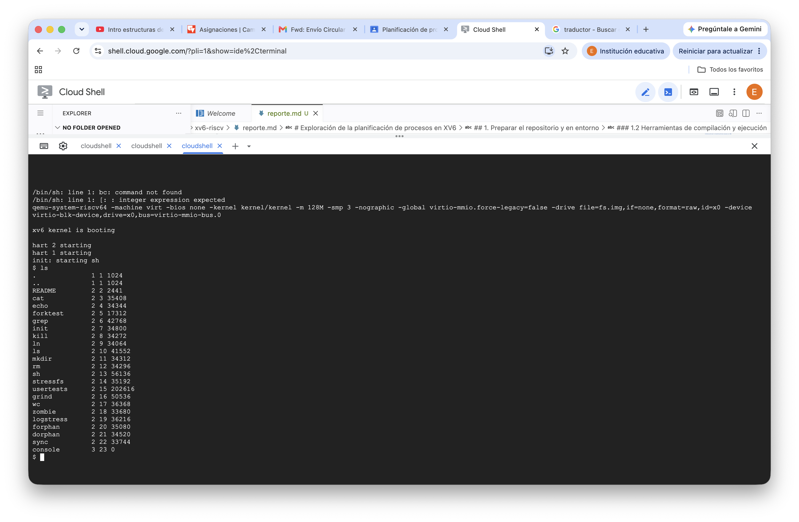
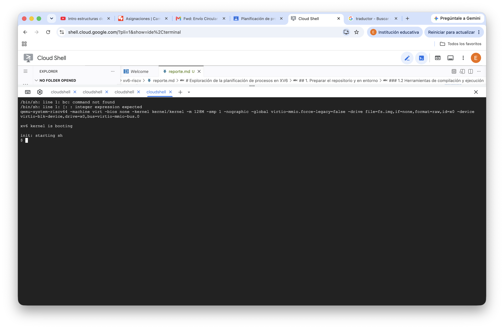
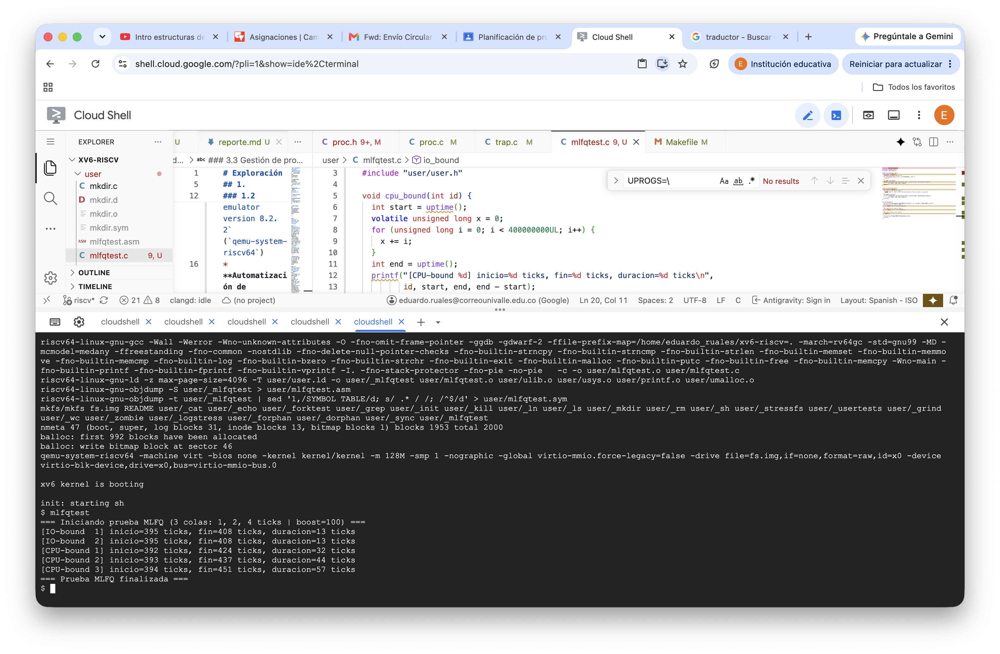

# Exploración de la planificación de procesos en XV6
* **Eduardo Andrés Ruales David**
* **Repositorio (Fork):** https://github.com/eduardoruales/xv6-riscv.git
---
## 1. Preparar el repositorio y el entorno

### 1.1 Fork, clonación y datos del entorno
* **Repositorio base:** `https://github.com/mit-pdos/xv6-riscv`
* **Sistema operativo Linux utilizado:** Ubuntu 24.04.5 LTS (`Linux cs-306848980572-default 6.18.59+ x86_64`)
* **Identificador del commit inicial:** `fa2ddcb` (`usertests: bound the zero-length pipe read regression test`)

### 1.2 Herramientas de compilación y ejecución
Se instalaron las dependencias requeridas en Ubuntu mediante `apt-get` (`build-essential`, `gdb-multiarch`, `qemu-system-misc`, `gcc-riscv64-linux-gnu`, `binutils-riscv64-linux-gnu`), obteniendo las siguientes versiones:
* **Compilador cruzado RISC-V:** `riscv64-linux-gnu-gcc 13.3.0`
* **Emulador:** `QEMU emulator version 8.2.2` (`qemu-system-riscv64`)
* **Automatización de construcción:** `GNU Make 4.3`


---

## 2. Compilar y ejecutar XV6 con 1 CPU virtual

### 2.1 Compilación y prueba básica del sistema
Se compiló el núcleo y los programas de usuario mediante `make qemu`, verificando la correcta inicialización del shell de XV6 (`hart 1 starting`, `hart 2 starting`) y la ejecución de comandos básicos del sistema como `ls`.



### 2.2 Configuración con una sola CPU virtual (`CPUS=1`)
Para restringir la emulación a un único núcleo virtual en QEMU, se ejecutó `make qemu CPUS=1`. Como se observa en el comando de lanzamiento generado por el sistema de construcción (`-smp 1`), QEMU inicia únicamente una CPU virtual (`hart 0`) con XV6 completamente operativo.



---

## 3. Comprensión del planificador original de XV6

### 3.1 Política de planificación actual
XV6 utiliza una política de planificación **Round-Robin (turno rotatorio) preventivo** sin prioridades ni colas múltiples:
* El núcleo mantiene una tabla global fija de procesos (`struct proc proc[NPROC]`, donde `NPROC = 64` definido en `kernel/param.h`).
* Cada CPU ejecuta un bucle infinito en `scheduler()` (`kernel/proc.c`) que recorre secuencialmente el arreglo `proc[]` desde el índice `0` hasta `NPROC - 1`.
* El primer proceso encontrado en estado `RUNNABLE` recibe la CPU durante un cuanto de tiempo (*time slice*) delimitado por las interrupciones periódicas del temporizador de hardware (*timer interrupts*).
* Cuando vence el cuanto de tiempo o el proceso bloquea por entrada/salida, cede el procesador y el planificador continúa inspeccionando la siguiente entrada del arreglo.

### 3.2 Funciones y estructuras clave del planificador
* **`struct proc` (`kernel/proc.h`):** Representa el Bloque de Control de Proceso (PCB). Almacena el identificador (`pid`), el estado actual (`state`: `UNUSED`, `USED`, `SLEEPING`, `RUNNABLE`, `RUNNING`, `ZOMBIE`), el candado interno (`lock`), el contexto de registros de kernel (`struct context context`), el *trapframe* de usuario (`struct trapframe *trapframe`) y el apuntador a su pila de kernel (`kstack`).
* **`scheduler()` (`kernel/proc.c`):** Función principal de planificación ejecutada por cada CPU al finalizar el arranque (`main()`). Recorre continuamente `proc[]` buscando procesos `RUNNABLE`, cambia su estado a `RUNNING`, asigna `c->proc = p` e invoca `swtch()` para transferir el control al proceso.
* **`sched()` (`kernel/proc.c`):** Valida invariantes críticas (que se posea `p->lock`, que `mycpu()->noff == 1`, que el estado no sea `RUNNING` y que las interrupciones estén deshabilitadas) y realiza el cambio de contexto de vuelta hacia `c->scheduler` mediante `swtch()`.
* **`yield()` (`kernel/proc.c`):** Invocada desde `usertrap()` y `kerneltrap()` cuando ocurre una interrupción del temporizador (`which_dev == 2`). Adquiere `p->lock`, cambia el estado del proceso actual de `RUNNING` a `RUNNABLE` y llama a `sched()` para ceder la CPU.
* **`swtch()` (`kernel/swtch.S`):** Rutina en ensamblador RISC-V que guarda los registros *callee-saved* (`ra`, `sp`, `s0`–`s11`) del contexto actual en la primera estructura `struct context*` y restaura los registros de la segunda estructura `struct context*`, materializando el cambio de flujo de ejecución entre el hilo del planificador y el hilo de kernel del proceso.

### 3.3 Gestión de programas de usuario y compilación (`Makefile`)
* **Ubicación de programas de usuario:** Los programas ejecutables del espacio de usuario residen en el directorio `user/` (por ejemplo, `user/sh.c`, `user/ls.c`, `user/cat.c`).
* **Proceso de integración en el `Makefile`:** Para incorporar un nuevo programa de usuario en XV6:
  1. Se crea su código fuente en `user/nombre.c` (incluyendo `"kernel/types.h"` y `"user/user.h"`, y finalizando con `exit(0)`).
  2. Se registra la entrada `$U/_nombre\` dentro de la variable `UPROGS` en el `Makefile`.
  3. Durante `make`, el sistema compila `user/nombre.c`, lo enlaza contra la biblioteca estándar de usuario (`ulib.o`, `usys.o`, `printf.o`, `umalloc.o`) con punto de entrada `main` (`-e main -Ttext 0`) generando el binario `_nombre`, y finalmente la herramienta `mkfs/mkfs` empaqueta todos los binarios de `UPROGS` dentro de la imagen de disco `fs.img`.
#### Fragmentos de código y compilación del planificador en el kernel

* **Selección del siguiente proceso (`kernel/proc.c` — función `scheduler()`):**
```c
for(p = proc; p < &proc[NPROC]; p++) {
  acquire(&p->lock);
  if(p->state == RUNNABLE) {
    p->state = RUNNING;
    c->proc = p;
    swtch(&c->context, &p->context);
    c->proc = 0;
  }
  release(&p->lock);
}
```
* **Cesión por interrupción de temporizador (`kernel/trap.c` — `usertrap()` y `kernel/proc.c` — `yield()`):**
```c
// En kernel/trap.c (usertrap):
if(which_dev == 2)
  yield();

// En kernel/proc.c (yield):
void yield(void) {
  struct proc *p = myproc();
  acquire(&p->lock);
  p->state = RUNNABLE;
  sched();
  release(&p->lock);
}
```

* **Incorporación al binario del kernel (`Makefile` — `OBJS` y regla `$K/kernel`):**
```makefile
OBJS = \
  $K/proc.o \
  $K/swtch.o \
  $K/trap.o \

$K/kernel: $(OBJS)$K/kernel.ld
	$(LD) $(LDFLAGS) -T$K/kernel.ld -o $K/kernel$(OBJS)
```

---

## 4. Descripción de MLFQ y exploración de su incorporación en XV6

### 4.1 Descripción inicial, dudas y Prompt 1

#### Comprensión inicial y dudas previas
Antes de consultar a la IA, la comprensión del algoritmo **MLFQ (*Multi-Level Feedback Queue*)** partía de la necesidad de superar la limitación de Round-Robin en XV6, donde todos los procesos reciben exactamente el mismo trato sin distinguir si son tareas interactivas cortas o procesos pesados de cómputo:

* **Reglas conocidas inicialmente:**
  1. Existen múltiples colas con distintos niveles de prioridad; los procesos en una cola superior siempre tienen preferencia sobre los de una cola inferior.
  2. Todo proceso nuevo ingresa en la cola de mayor prioridad asumiendo que puede ser una tarea corta o interactiva.
  3. Si un proceso consume todo su tiempo asignado (*quantum*) en la CPU, es degradado a una cola de menor prioridad; si libera la CPU antes de agotar el quantum (por ejemplo, esperando entrada/salida), conserva su prioridad.
* **Dudas identificadas inicialmente:**
  * ¿Cuántos niveles de cola y qué duración exacta de *quantum* (en *ticks* de temporizador) son adecuados para XV6 sin disparar el costo de cambio de contexto?
  * ¿Cómo evitar que un proceso intensivo en CPU degradado a la cola más baja sufra **inanición (*starvation*)** indefinida cuando llegan continuamente procesos cortos?
  * ¿Qué sucede con la estructura interna del kernel de XV6 (`struct proc`, `scheduler()`, `trap.c`) que actualmente recorre un único arreglo plano `proc[NPROC]`?

#### Registro del Prompt 1 y retroalimentación de la IA
> **Prompt 1 enviado a la IA:**
> *"Con base en el análisis del planificador Round-Robin de XV6 (`kernel/proc.c` y `kernel/trap.c`), se entiende que MLFQ organiza los procesos en múltiples colas de prioridad, inicia los procesos nuevos en la cola más alta, los degrada si consumen todo su quantum y mantiene la prioridad de quienes ceden la CPU por E/S. Sin embargo, tuve dudas sobre: (1) cuántos niveles de cola y quantums en ticks conviene definir para XV6, (2) cómo evitar la inanición de procesos largos mediante priority boost, y (3) qué cambios exactos se requieren en los archivos y funciones de XV6 para incorporar MLFQ y cómo verificar sus reglas mediante escenarios de prueba."*

* **Retroalimentación y consolidación del algoritmo:**
  La IA formuló las **5 reglas formales de MLFQ** aplicadas a un entorno de 1 CPU (`CPUS=1`) en XV6:
  1. **Regla 1:** Si $\text{Prioridad}(A) > \text{Prioridad}(B)$, se ejecuta $A$.
  2. **Regla 2:** Si $\text{Prioridad}(A) = \text{Prioridad}(B)$, se ejecutan en Round-Robin dentro de esa misma cola.
  3. **Regla 3:** Al crearse o entrar al sistema, todo proceso inicia en la **Cola 0** (máxima prioridad).
  4. **Regla 4:** Una vez que un proceso agota su asignación de tiempo en un nivel dado (independientemente de cuántas veces haya cedido la CPU antes), su prioridad se reduce (degradación). Se consolidó un esquema de **3 colas** con quantums crecientes: **Cola 0 (1 tick)**, **Cola 1 (2 ticks)** y **Cola 2 (4 ticks)**.
  5. **Regla 5 (*Priority Boost*):** Cada **100 ticks** globales del sistema, todos los procesos vuelven a la **Cola 0** para prevenir inanición y adaptarse a cambios de fase en el comportamiento de los procesos.

---

### 4.2 Propuesta de cambios en el código fuente de XV6

Para incorporar MLFQ en `xv6-riscv`, se identificaron las siguientes modificaciones estructuradas por archivo y función:

1. **Atributos de planificación en el PCB — `kernel/proc.h` (`struct proc`):**
   * **Cambio propuesto:** Añadir los campos `int queue;` (nivel de cola actual: `0`, `1` o `2`) e `int ticks_used;` (contador de ticks consumidos en el nivel actual).
   * **Necesidad que atiende y por qué:** El `struct proc` original solo almacena el estado (`RUNNABLE`, `RUNNING`, etc.) pero carece de historial de comportamiento. Estos campos permiten que el kernel recuerde la prioridad dinámica de cada proceso entre cambios de contexto.
2. **Inicialización de nuevos procesos — `kernel/proc.c` (`allocproc()`):**
   * **Cambio propuesto:** Inicializar `p->queue = 0;` y `p->ticks_used = 0;` al reservar una entrada libre en la tabla de procesos.
   * **Necesidad que atiende y por qué:** Garantiza el cumplimiento de la **Regla 3**, asegurando que todo proceso recién creado (`fork`/`exec`) obtenga respuesta inmediata en la cola más alta.
3. **Contabilización de ticks y degradación — `kernel/trap.c` (`usertrap()` y `kerneltrap()`):**
   * **Cambio propuesto:** Cuando ocurre una interrupción del temporizador (`which_dev == 2`) con un proceso en ejecución (`p != 0 && p->state == RUNNING`), incrementar `p->ticks_used++`. Si `p->ticks_used` alcanza el quantum de su cola (`1`, `2` o `4` ticks), reiniciar `p->ticks_used = 0`, incrementar `p->queue++` (hasta el límite `2`) y llamar a `yield()`. Si aún no agota su quantum, mantenerlo en su cola actual sin ceder forzadamente.
   * **Necesidad que atiende y por qué:** Implementa la **Regla 4** en el punto exacto donde el hardware genera los pulsos de reloj en RISC-V, permitiendo distinguir procesos intensivos en CPU (que agotan su quantum y descienden) de procesos interactivos o E/S (que ceden antes vía `sleep()`/`pause()`).
4. **Selección por prioridad y envejecimiento global — `kernel/proc.c` (`scheduler()`):**
   * **Cambio propuesto:** Reemplazar el recorrido único del arreglo `proc[NPROC]` por un ciclo externo de prioridad (`for(int q = 0; q < 3; q++)`) que busca procesos `RUNNABLE` pertenecientes a la cola `q` más alta disponible (reiniciando la búsqueda desde `q = 0` tras cada despacho). Adicionalmente, llevar un contador de ticks para ejecutar cada **100 ticks** un recorrido global que restablezca `p->queue = 0` y `p->ticks_used = 0` en todos los procesos activos.
   * **Necesidad que atiende y por qué:** Atiende las **Reglas 1, 2 y 5**, garantizando que las colas superiores se vacíen antes de atender las inferiores y evitando la inanición permanente de procesos ubicados en la Cola 2.

#### Decisiones de diseño que requieren investigación o corroboración adicional
* **Calibración de quantums (1, 2 y 4 ticks) y periodo de *boost* (100 ticks):** Estos valores son heurísticos iniciales. En hardware real o cargas pesadas, un quantum de 1 tick puede incrementar la sobrecarga por cambios de contexto (`swtch()`), mientras que un *boost* cada 100 ticks podría ser demasiado frecuente o insuficiente según la carga de trabajo; requiere corroboración experimental midiendo tiempo de respuesta y *throughput*.
* **Mitigación de *Gaming the Scheduler*:** En el diseño propuesto, si un proceso malicioso ejecuta una llamada corta de E/S o `pause(1)` justo antes de completar su quantum sin reiniciar o contabilizar adecuadamente el tiempo acumulado en el nivel, podría permanecer indefinidamente en la Cola 0 monopolizando la CPU. Se requiere verificar si `ticks_used` debe conservarse hasta agotar el quantum completo del nivel antes de reiniciarse.

---

### 4.3 Conclusiones de la exploración y retroalimentación

* **Conclusiones propias:** El planificador original de XV6 es simple pero injusto frente a cargas mixtas, ya que trata igual a un proceso interactivo que a un ciclo infinito de cálculo. Incorporar MLFQ no requiere crear estructuras dinámicas complejas de listas enlazadas en el kernel (lo cual complicaría el manejo de memoria y bloqueos `spinlock` en XV6), sino aprovechar la tabla estática `proc[NPROC]` filtrada por niveles de cola y acoplada a las interrupciones de reloj en `trap.c`.
* **Retroalimentación de la IA:** Se validó que mantener la tabla estática `proc[NPROC]` filtrada por `p->queue` preserva la seguridad de concurrencia mediante los `p->lock` nativos de XV6 sin riesgo de fugas de memoria en el kernel, y se enfatizó que todas las pruebas de validación deben ejecutarse con `CPUS=1` para observar determinísticamente la competencia por un único núcleo.

---

### 4.4 Escenarios propuestos para validar la implementación de MLFQ

Para comprobar el cumplimiento de las reglas de MLFQ sobre XV6 configurado con una sola CPU (`CPUS=1`), se proponen los siguientes cuatro escenarios de prueba:

1. **Escenario 1 — Prioridad inicial y degradación progresiva (Reglas 3 y 4):**
   * **Procesos participantes:** Un único proceso intensivo en CPU (`CPU-bound`) que ejecuta un bucle matemático continuo sin llamadas al sistema de E/S.
   * **Regla a comprobar:** Todo proceso inicia en la Cola 0 y desciende progresivamente a Cola 1 y Cola 2 al agotar cada quantum.
   * **Comportamiento esperado:** Al iniciarse, el proceso entra inmediatamente en `q = 0`; tras consumir 1 tick desciende a `q = 1`; tras consumir 2 ticks adicionales desciende a `q = 2` (quantum de 4 ticks), donde permanece ejecutándose hasta que ocurra un *priority boost*.
2. **Escenario 2 — Aislamiento y baja latencia para procesos interactivos (Reglas 1 y 4):**
   * **Procesos participantes:** Dos procesos `CPU-bound` de larga duración ejecutándose concurrentemente con dos procesos `IO-bound` que alternan cómputo breve con pausas voluntarias (`pause(1)`).
   * **Regla a comprobar:** Los procesos que liberan la CPU antes de agotar su quantum mantienen prioridad alta y prevalecen sobre procesos degradados.
   * **Comportamiento esperado:** Los procesos `CPU-bound` descienden rápidamente a la Cola 2, mientras los `IO-bound` permanecen en la Cola 0 y completan su ejecución en significativamente menos ticks que los `CPU-bound`, sin sufrir bloqueos por el cálculo pesado.
3. **Escenario 3 — Reparto equitativo dentro de una misma cola (Regla 2):**
   * **Procesos participantes:** Tres procesos `CPU-bound` idénticos lanzados simultáneamente sin procesos interactivos presentes.
   * **Regla a comprobar:** Procesos ubicados en el mismo nivel de prioridad se planifican en Round-Robin.
   * **Comportamiento esperado:** Los tres procesos descienden en paralelo a la Cola 2 y se alternan equitativamente en turnos de 4 ticks cada uno, finalizando con tiempos totales de ejecución muy cercanos entre sí.
4. **Escenario 4 — Prevención de inanición mediante *Priority Boost* (Regla 5):**
   * **Procesos participantes:** Un proceso `CPU-bound` largo degradado en la Cola 2 junto con una ráfaga continua de procesos cortos/interactivos que ocupan constantemente la Cola 0.
   * **Regla a comprobar:** El envejecimiento global cada 100 ticks evita que los procesos en colas bajas queden bloqueados indefinidamente.
   * **Comportamiento esperado:** Aunque durante los primeros 100 ticks el proceso `CPU-bound` apenas avanza debido a la prioridad de la Cola 0, al cumplirse los 100 ticks todos los procesos regresan a `q = 0`, permitiendo que el proceso pesado reciba nuevamente turnos de CPU y logre avanzar hasta terminar.


---

## 5. Implementación Realizada, Pruebas y Consolidación Final

Para validar el planificador sobre 1 CPU virtual (`make qemu CPUS=1`), se implementó el programa de usuario `user/mlfqtest.c`, que ejecuta concurrentemente 3 procesos intensivos en CPU (`CPU-bound`) y 2 procesos interactivos con esperas periódicas (`IO-bound`).



### Análisis del comportamiento observado

* **Baja latencia para procesos interactivos:** Los procesos `IO-bound 1` e `IO-bound 2` completaron su ejecución en **13 ticks** cada uno, ya que ceden voluntariamente el procesador antes de agotar el quantum de 1 tick y permanecen en la **Cola 0** con máxima prioridad.
* **Penalización progresiva para carga CPU:** Los procesos `CPU-bound 1`, `CPU-bound 2` y `CPU-bound 3` consumieron sus quantums completos, descendiendo progresivamente hacia la **Cola 2** (4 ticks) y finalizando en **32**, **44** y **57 ticks** respectivamente, demostrando el aislamiento efectivo entre cargas interactivas y de cómputo intensivo.
